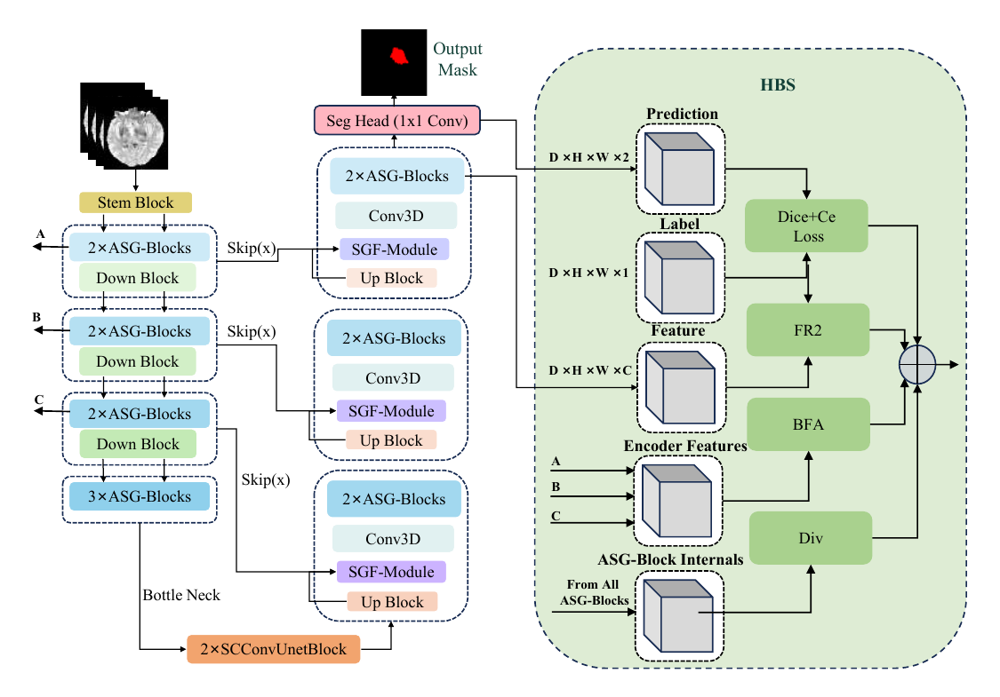

# ASG-Net

**Adaptive spectral gating and boundary-aware supervision for LGG segmentation from limited MRI**

ASG-Net is a 3D PyTorch model for low-grade glioma segmentation from FLAIR MRI. It uses high- and low-frequency experts with input-adaptive channel-wise fusion, semantic gating on skip connections, and hierarchical boundary-oriented supervision during training.

[Paper DOI](https://doi.org/10.1016/j.bspc.2026.111829)

## Method overview



*Figure 2 from the paper. ASG blocks process the encoder and decoder features, SGF refines the skip connections, and HBS combines the training losses.*

## Installation

Install [PyTorch](https://pytorch.org/get-started/locally/) for your CPU or GPU, then run the following from the repository root. Training requires Python 3.10 or newer.

```bash
pip install -e .
python scripts/smoke_test.py
```

## PyTorch inference

```python
import torch
from asgnet import ASGNet_SC

model = ASGNet_SC(in_chans=1, num_classes=2).eval()
# Load weights from a checkpoint trained with this implementation before prediction.
with torch.inference_mode():
    logits = model(torch.zeros(1, 1, 24, 24, 24))
    prediction = logits.argmax(dim=1)
```

The input is `(batch, channels, depth, height, width)`. Patch axes must be at least 24 voxels and divisible by 8. Use `in_chans=4` for a model trained on four concatenated MRI channels. The example verifies the tensor interface with randomly initialized weights.

## Training with nnU-Net v2

The trainer is written for nnU-Net v2.6.2. Install the training dependencies and register the trainer in the same Python environment.

```bash
pip install -e ".[training]"
python -c "import shutil, nnunetv2; from pathlib import Path; shutil.copy2('nnUNetTrainerASGNet.py', Path(nnunetv2.__file__).parent / 'training' / 'nnUNetTrainer' / 'nnUNetTrainerASGNet.py')"
```

Set `nnUNet_raw`, `nnUNet_preprocessed`, and `nnUNet_results` as in the [nnU-Net documentation](https://github.com/MIC-DKFZ/nnUNet/tree/v2.6.2/documentation). Prepare an nnU-Net dataset with background label 0 and whole-lesion label 1. For FLAIR-only inputs, place one `_0000.nii.gz` image per case in `imagesTr` and its mask in `labelsTr`. Use patient-level splits in `splits_final.json` when comparing results across configurations.

```bash
DATASET_ID=511  # Replace with your local dataset ID.
nnUNetv2_plan_and_preprocess -d "$DATASET_ID" -c 3d_fullres --verify_dataset_integrity
export nnUNet_compile=false
for fold in 0 1 2 3 4; do
  nnUNetv2_train "$DATASET_ID" 3d_fullres "$fold" -tr nnUNetTrainerASGNet || break
done
nnUNetv2_predict -i /path/to/imagesTs -o /path/to/predictions \
  -d "$DATASET_ID" -c 3d_fullres -tr nnUNetTrainerASGNet -f 0 1 2 3 4
```

The trainer uses AdamW, an initial learning rate of `1e-3`, weight decay `0.01`, and 200 epochs. Batch size and patch size come from the plans. The manuscript settings were batch size 2 and patches of `128 x 128 x 128` for TCGA-LGG and `96 x 160 x 160` for DLGG. The example command generates standard nnU-Net plans. If using custom plans, pass the same plan identifier with `-p` to training and prediction. For a four-channel experiment, prepare a separate dataset with FLAIR, T1-weighted, contrast-enhanced T1-weighted, and T2-weighted channels in that order.

## Implementation and reproducibility

- `asgnet/model.py` contains the ASG backbone, its 3D SCConv blocks, and semantic gating fusion.
- `asgnet/losses.py` contains the boundary feature alignment (BFA) and foreground feature regularization (FR2) losses. The training objective also includes the pooled cosine-similarity penalty and anneals only the BFA term.
- `nnUNetTrainerASGNet.py` integrates the network and losses with nnU-Net.

This public implementation follows the method described in the paper. Compared with an earlier local trainer variant, it uses per-channel expert gates and aligns the auxiliary objective with the manuscript equations, including the cosine penalty, BFA-only annealing, and the normalized-feature FR2 prototype. Gate-layer weights from the older scalar-gate variant are not shape-compatible. Published scores have not been reproduced with this release. Datasets, historical preprocessing plans and fold assignments, and trained weights are not included.

The 3D reconstruction blocks build on **SCConv: Spatial and Channel Reconstruction Convolution for Feature Redundancy**. FR2 builds on the feature regularization described in [HCMA-UNet](https://arxiv.org/abs/2501.00751). The training interface uses [nnU-Net v2](https://github.com/MIC-DKFZ/nnUNet).

## Citation

```bibtex
@article{lin2026asgnet,
  title   = {{ASG-Net}: Adaptive spectral gating and boundary-aware supervision for {LGG} segmentation from limited {MRI}},
  author  = {Lin, Jun and Zhang, Wang and Huang, Yigeng and Wang, Qi and
             Yao, Yang and Jiang, Yan and Wei, Wei and Zhao, Jing and
             Wang, Huanqin and Fei, Xiaorui},
  journal = {Biomedical Signal Processing and Control},
  year    = {2026},
  doi     = {10.1016/j.bspc.2026.111829}
}
```
